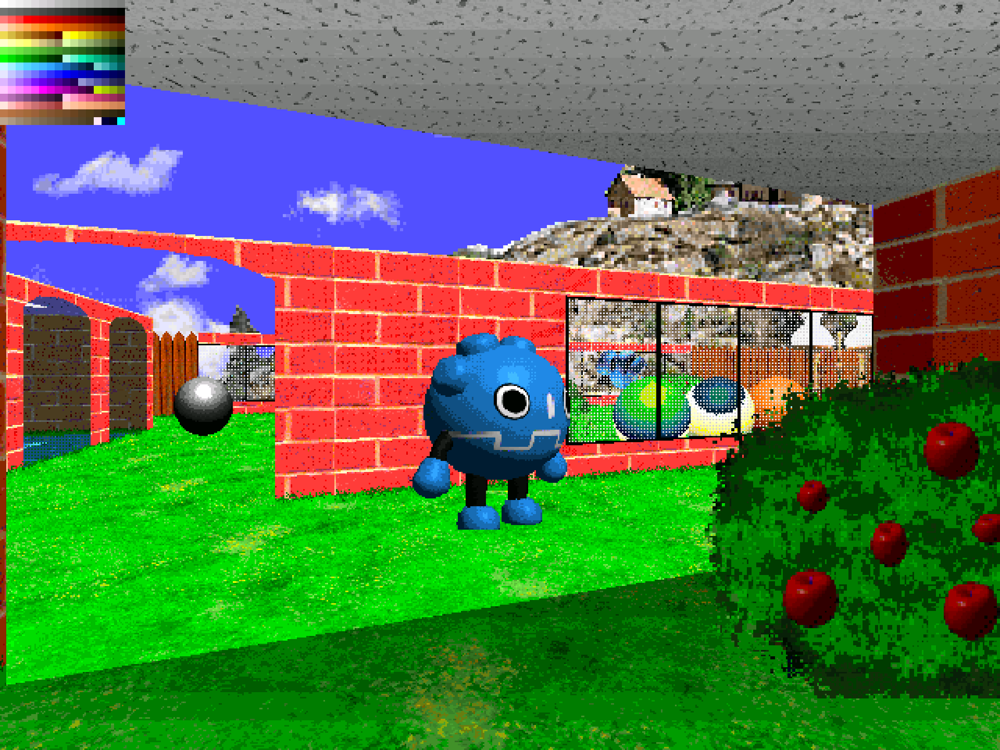

***DISCLAIMER!*** If you'd like to submit a pull request to this project, *please* share what you're cooking up in [Discussions](https://github.com/The-HandyDandyman/godot-doom-esque-visuals/discussions/categories/ideas) first!
-----

Hello! My name's Dandy, and I'm somebody who likes programming and has been working on a project inspired by old, cheap, 3D first person PC games! 
Due to this, the commitment to authenticity for that aforementioned project and the fact I have a feeling there are more people besides I who are probably interested in that sort of niche:
I've made this open source Github repo packaged with the shaders I use and some
stock assets seperate from my original project, specifically to act as a way to both share what I've managed to start so far and as a way to hopefully get assistance on specific aspects!

-----
# If you'd like to learn how to use this, it is recommended you go read over here! https://github.com/The-HandyDandyman/godot-doom-esque-visuals/wiki
Credits are also listed if you are curious as to who (both directly and indirectly) contributed to this project!
